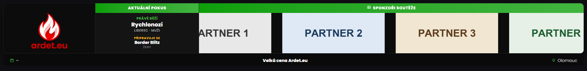
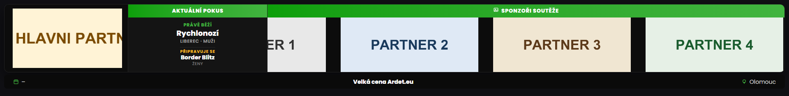
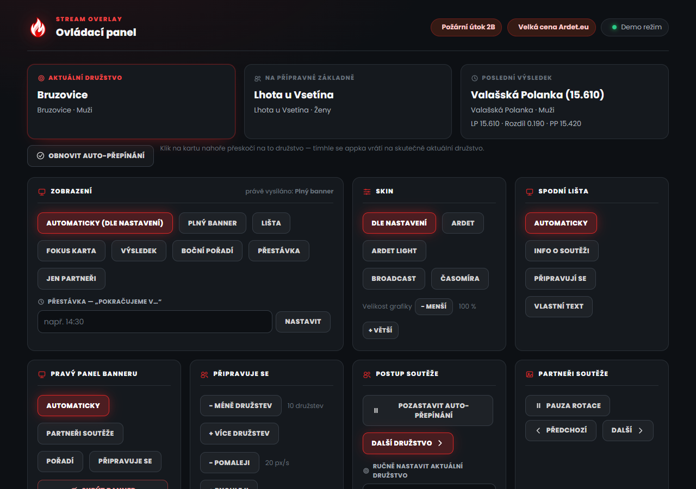

# Ardet Stream Overlay

Spodní banner pro streamy soutěží požárního sportu (better-sport / ardet.eu) —
aktuální/další tým, poslední výsledek, průběžné pořadí a rotující loga
sponzorů. Běží lokálně u obsluhy streamu, nic se nikam neinstaluje do cloudu.

## Jak to vypadá

Banner v OBS (přes průhledné pozadí), s vlastní barvou zvýraznění nastavenou
v Nastavení:

Levá část banneru je rotátor — když je ve složce `main-sponsors/` aspoň jedno
logo, střídá se se znakem Ardet (na obrázku výše je složka prázdná, proto je
vidět jen znak):

Ovládací panel (`/control`), odkud se za běhu appky řídí, co se na banneru
zrovna ukazuje:

## Stažení a spuštění

1. Stáhni nejnovější `stream-overlay-windows-x64.zip` ze
   [Releases](../../releases) a rozbal do vlastní složky. Kromě
   `stream-overlay.exe` tam bude i složka `_internal/` (knihovny, které exe
   potřebuje) — nech ji vedle exe, nepřesouvej exe samotné jinam.
2. V rozbalené složce spusť `stream-overlay.exe`. Otevře se okno příkazové
   řádky (appka v něm běží — nezavírej ho) a appka vedle sebe rovnou založí
   dvě prázdné složky — `sponsors/` a `main-sponsors/` (víc o nich níž). V
   prohlížeči se automaticky otevře stránka **Nastavení**
   (`http://localhost:5000/settings`).
3. Na stránce Nastavení:
   - Do pole soutěže napiš/vyhledej svou soutěž a vyber ji ze seznamu
     (adresa API je předvyplněná na `https://ardet.eu`).
   - Nastav jazyk banneru, výšku, barvu zvýraznění, rychlost rotace
     sponzorů a co všechno se má zobrazovat.
   - Ulož.
4. V OBS/vMix přidej **Browser Source** s adresou
   `http://localhost:5000/overlay` (rozlišení 1920×1080, pozadí je
   průhledné).
5. Vedle si otevři `http://localhost:5000/control` — odsud za běhu appky
   přepínáš scény (sponzoři/pořadí/připravuje se), posíláš tým na "další",
   pauzuješ automatické otáčení, schováváš banner apod.

## Co dělat se složkami `sponsors/` a `main-sponsors/`

Appka je založí sama, hned při prvním spuštění, vedle `stream-overlay.exe`.
Obě umí PNG/JPG/SVG/WEBP — appka soubory v nich sama najde, není potřeba nic
nikde ručně registrovat.

- **`sponsors/`** — loga partnerů soutěže. Zobrazují se v pravém panelu
  banneru (mřížka/kolotoč, podle nastavení "Styl přepínání log"), střídají se
  s průběžným pořadím a "Připravuje se" podle nastavené doby rotace.
- **`main-sponsors/`** — logo(a) hlavního/titulárního partnera. Zobrazují se
  v **levém** panelu banneru, kde se střídají se znakem Ardet:
  - **Složka prázdná** → v levém panelu je pořád jen znak Ardet, žádné
    přepínání ani animace.
  - **1+ log** → znak Ardet a loga hlavních partnerů se v tom samém místě
    postupně střídají (rychlost jde nastavit v poli "Pauza mezi partnery").
  - Zobrazování hlavních partnerů jde v Nastavení i úplně vypnout (přepínač
    "Zobrazovat hlavního partnera") — pak je to stejné jako prázdná složka.

Loga nahazuj/měň za běhu appky klidně za provozu — appka je čte znovu při
každém načtení stránky/rotaci, restart není potřeba.

## Vypnutí

V okně příkazové řádky, kde appka běží, stiskni `Ctrl + C`, nebo okno
zavři.

## Když něco nejde

- **Port 5000 už používá jiný program** → uprav v Nastavení port appky
  (dole na stránce), nebo zavři program, který port 5000 blokuje.
- **Windows Defender appku zablokoval / dal do karantény, zip nejde
  otevřít ("Přístup byl odepřen")** → appka je nepodepsaná (chybí drahý
  code-signing certifikát), a Windows Defender u nepodepsaných PyInstaller
  aplikací dost často vyhodí falešný poplach — je to o balíčkovacím
  nástroji, ne o kódu appky samotné (zdrojáky jsou veřejně v tomhle repu).
  Postup, jak se k appce dostat:
  1. **Windows Security** (Start → napiš "Windows Security") → **Virus &
     threat protection** → dole **Protection history**.
  2. Najdi záznam se `stream-overlay.exe` (jméno detekce bude nějaké obecné,
     typu `Trojan:Script/Wacatac`, `Program:Win32/Wacapew` apod. — časté
     generické false-positive u PyInstaller aplikací).
  3. Klikni na něj → **Actions** → **Restore** (případně rovnou nabídne
     "Allow on device").
  4. Pokud SmartScreen ještě zablokuje samotné spuštění ("Windows
     protected your PC") → **More info** → **Run anyway**.
  - Chceš appku po tomhle Microsoftu i nahlásit jako false-positive (aby
    do budoucna přestala padat do karantény)? Jdi na
    [microsoft.com/wdsi/filesubmission](https://www.microsoft.com/en-us/wdsi/filesubmission),
    nahraj obnovený `stream-overlay.exe`, zvol že nesouhlasíš s detekcí.
    Microsoft do pár dní whitelistne tenhle konkrétní build (týká se ale
    jen aktuální verze — každý další release má jiný soubor/hash, takže se
    to může zopakovat).
- **Na `/overlay` nic není** → appka musí běžet a v Nastavení musí být
  vybraná soutěž.
- **Chci appku vidět s testovacími daty bez zásahu do živé soutěže** →
  v Nastavení zapni Demo režim.

## Licence

Viz [LICENSE](LICENSE) — appka je zdarma k použití, ale bez svolení autora
není dovoleno upravovat kód/program ani odstraňovat znak Ardet z banneru.

## Poznámky

- Pořadí týmů se za běhu soutěže může měnit (pořadatel může přeuspořádat
  startovku) — appka si nic nepamatuje podle pozice, "kdo je na řadě"
  počítá vždy znovu z aktuálních dat.
- "Zobrazit čas" = výsledný čas doběhnutého pokusu (appka nemá signál
  start/stop běžícího pokusu, jen výsledek po jeho dokončení).
- Pokud má soutěž víc startovních listin se souběžnými čísly, "Připravuje
  se" mezi nimi ukazuje dělič s názvem další listiny.
- Ligové týmy jsou v pořadí i v "Připravuje se" označené štítkem "LIGA".
