

# Ardet Stream Overlay

**Grafika pro živé přenosy soutěží požárního sportu.** Napojená na výsledky z
[ardet.eu](https://ardet.eu), běží u tebe na počítači a v OBS/vMixu se přidá
jako Browser Source.

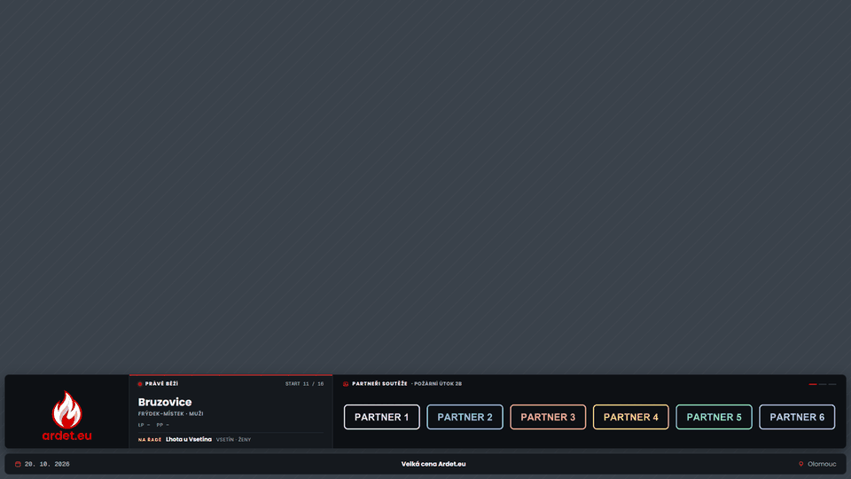

[**⬇ Stáhnout pro Windows**](../../releases/latest) · [Jak začít](#-jak-začít-za-5-minut) · [Skiny](#-skiny) · [Zobrazení](#-zobrazení) · [Disciplíny](#-disciplíny) · [Když něco nejde](#-když-něco-nejde)

---

## Co umí

|   |   |
|---|---|
| 🔥 **Živě z ardet.eu** | Kdo zrovna běží a kdo je na řadě. Časy LP/PP nebo obou pokusů, výsledný čas, průběžné pořadí a ztráta na vedoucího. Vše se načítá samo. |
| 🎨 **4 skiny** | Ardet, Ardet Light, Broadcast a Časomíra. Každý skin funguje v každém zobrazení. |
| 🖥️ **7 zobrazení** | Plný banner, lišta, fokus karta, výsledek pokusu, boční pořadí, přestávka a jen partneři. Přepínají se živě z ovládacího panelu. |
| 🏆 **Výsledek hned po doběhu** | Po doběhu se automaticky na pár sekund ukáže velký výsledek s místem a výřezem pořadí. Pak se overlay vrátí zpátky. |
| 🪣 **Požární útok i nálevka** | U útoku platí horší z terčů, u nálevky lepší ze dvou pokusů. Mezi pokusy nálevky ukazuje „čeká se na 2. pokus“ s průběžným časem. |
| ✍️ **Ruční časy a offline** | Časy jde zapsat ručně po jednotlivých pokusech (i NP). Když vypadne spojení s ardet.eu, jede se dál z uložených dat, i po restartu appky. Po obnovení spojení ardet.eu doplní jen to, co není zapsané ručně. |
| 🔠 **Velikost grafiky** | Písmo i rámečky jdou zvětšit globálně nebo pro jednotlivá zobrazení, aby to bylo čitelné i na mobilu. Za běhu tlačítky −/+ v `/control`. |
| 🖌️ **Vlastní barvy** | Barvy jde přepsat globálně, nebo zvlášť pro každé zobrazení: písmo, čísla, zvýraznění, pozadí… |
| 🤝 **Partneři** | Loga stačí nahrát do složky. Střídají se v banneru i na obrazovce přestávky. |
| 📴 **Funguje offline** | Písma i grafika jsou přibalené, nic se netahá z internetu kromě výsledků. |

## 🎨 Skiny

Skin určuje vzhled, zobrazení určuje rozložení. Kombinovat jde cokoliv s čímkoliv.

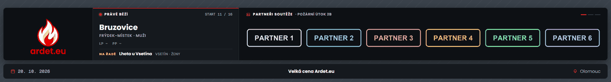

<b>Ardet</b> (výchozí): tmavý, stejné barvy a písmo jako ardet.eu

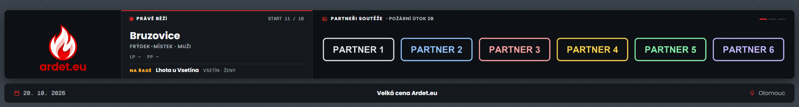

<b>Ardet Light</b>: světlý, na denní venkovní streamy

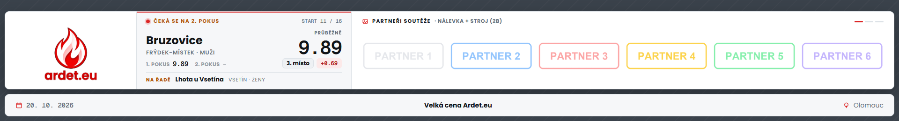

<b>Broadcast</b>: TV grafika se zkosenými bloky a velkými kurzívními časy

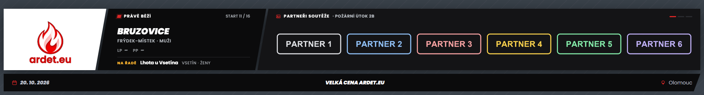

<b>Časomíra</b>: LED tabule jako na soutěži, se svítícími číslicemi

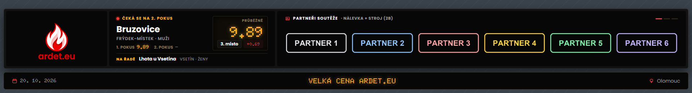

## 🖥️ Zobrazení

| | |
|---|---|
| 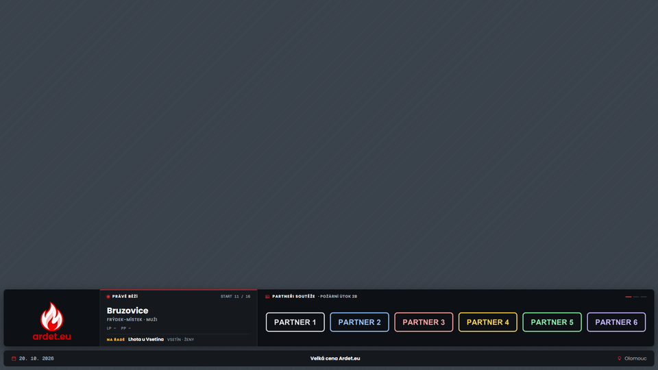 | **Plný banner:** aktuální pokus, znak/hlavní partner a pravý panel, který střídá partnery, pořadí a startovku. Pod ním lišta s názvem, datem a místem. |
| 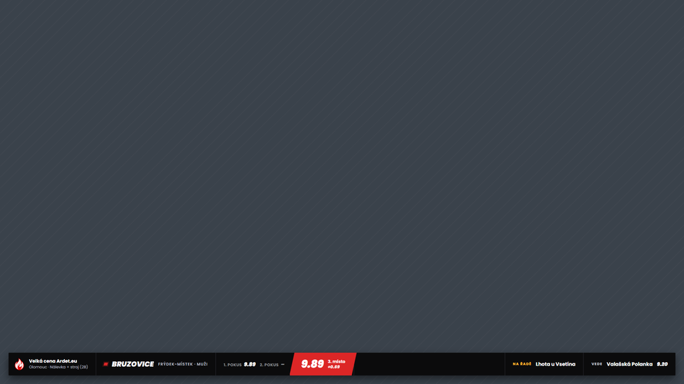 | **Lišta:** všechno podstatné v jednom tenkém řádku. Hodí se, když je potřeba vidět co nejvíc obrazu. |
| 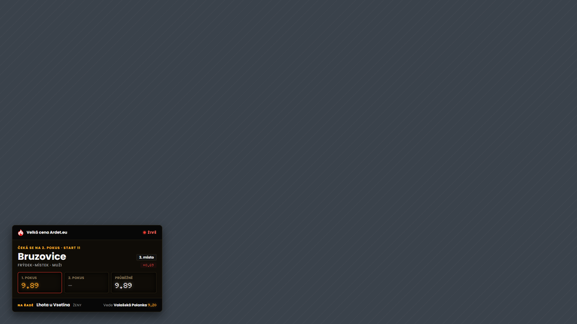 | **Fokus karta:** jen aktuální pokus v rohu obrazu. |
| 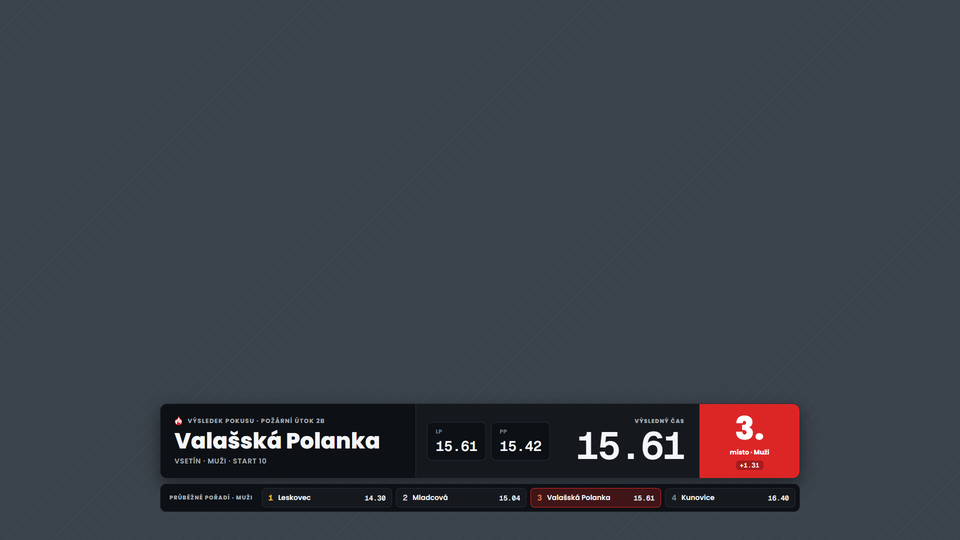 | **Výsledek pokusu:** velký čas, místo, ztráta a výřez pořadí. Ukazuje se automaticky po každém doběhu. |
| 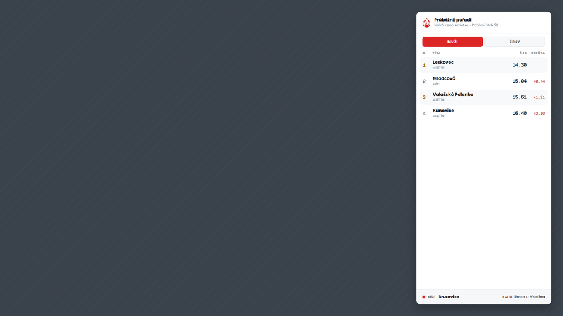 | **Boční pořadí:** tabulka kategorie přes celou výšku obrazu. Kategorie se střídají, dlouhý seznam se sám posouvá. |
| 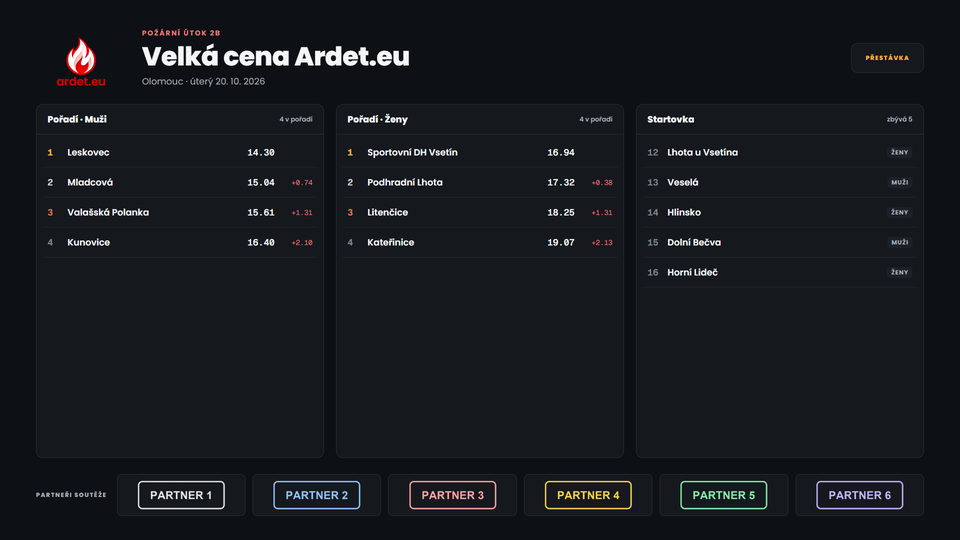 | **Přestávka:** celá obrazovka s pořadím, startovkou, partnery a textem „Pokračujeme v…“. |

K tomu ještě **Jen partneři**: plný banner, ve kterém jsou jen loga partnerů.

## 🪣 Disciplíny

Overlay pozná disciplínu podle soutěže na ardet.eu a podle ní počítá i popisuje časy:

| | Požární útok (2B, 3B, Flídr…) | Nálevka (+ stroj 1B/2B) |
|---|---|---|
| Dva časy | **LP / PP** (levý a pravý terč) | **1. pokus / 2. pokus** |
| Platí | **horší** z obou (útok končí až s druhým terčem) | **lepší** z obou platných pokusů |
| Mezi zápisy | „Čeká se na PP“ | „Čeká se na 2. pokus“ + průběžný čas a průběžné místo |
| Další tým | po zapsání obou terčů | až po zapsání **obou** pokusů |
| V pořadí | výsledný čas | lepší pokus + malým písmem ten druhý (nebo NP) |

> [!TIP]
> Když pořadatel druhý pokus nálevky nezapíše vůbec, tým v pořadí zůstane se svým
> lepším časem. Na další tým přepneš v ovládacím panelu tlačítkem **Další družstvo**.

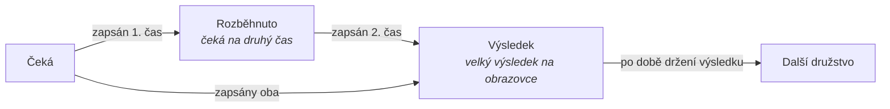

## 🚀 Jak začít (za 5 minut)

- [ ] **Stáhni** `stream-overlay-windows-x64.zip` z [Releases](../../releases/latest) a rozbal ho do vlastní složky. Složku `_internal/` nech vedle `stream-overlay.exe`.
- [ ] **Spusť** `stream-overlay.exe`. Otevře se okno příkazové řádky (appka v něm běží, nezavírej ho) a v prohlížeči stránka **Nastavení** (`http://localhost:5000/settings`).
- [ ] **Vyber soutěž**: začni psát název a klikni na ni v seznamu.
- [ ] **Vyber skin a zobrazení.** Náhled nahoře se mění hned. Pak klikni na **Uložit**.
- [ ] **Do OBS/vMixu** přidej **Browser Source** s adresou `http://localhost:5000/overlay`, velikost **1920×1080** přes celou scénu (pozadí je průhledné).
- [ ] **Vedle si otevři** `http://localhost:5000/control`, odkud se za běhu řídí, co je na obrazovce.

<b>Nastavení</b>: náhled, skiny, barvy

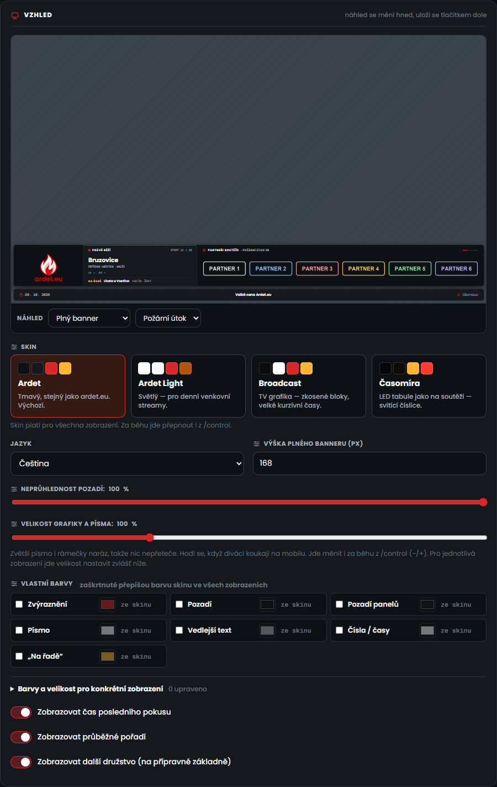

- **Vlastní barvy:** zaškrtnutá barva přepíše barvu skinu ve všech zobrazeních.
- **Barvy jen pro konkrétní zobrazení:** například lišta s bílým písmem a žlutými časy, zatímco plný banner zůstane podle skinu.
- **Velikost grafiky a písma:** posuvník 60–200 %. Zvětšuje text i rámečky naráz, takže nic nepřeteče. U každého zobrazení jde nastavit vlastní velikost (třeba větší lišta).
- **Umístění na obrazovce:** *Dole* počítá se zdrojem 1920×1080 přes celou scénu. *Nahoře* je pro starší nastavení, kde si zdroj posouváš a ořezáváš v OBS sám.
- **Demo režim:** testovací data (požární útok, nebo nálevka) pro ladění vzhledu bez živé soutěže.

<b>Ovládací panel</b> (<code>/control</code>): co jde řídit za běhu

- **Zobrazení a skin:** přepnou se okamžitě, bez obnovení zdroje v OBS.
- **Přestávka:** napiš „Pokračujeme v…“ (třeba `14:30`) a přepni na zobrazení Přestávka.
- **Postup soutěže:** další družstvo, pauza auto-přepínání, ručně zvolené aktuální družstvo, jak dlouho držet výsledek na obrazovce.
- **Startovka:** **▶ Na trať** pošle družstvo na trať (overlay ho hned ukáže). Nepřítomné týmy jsou skryté, zobrazit jde přepínačem.
- **Ruční časy (✎):** zapisují se po jednotlivých pokusech. Nálevka tedy jde po jednom: nejdřív 1. pokus, pak 2. Do pole jde čas (`14.30`, `1:02.5`), `NP` (neplatný), nebo nic (= podle ardet.eu). Ruční zápis má přednost. U zapsaného času je odznak **R**, a když ardet.eu hlásí něco jiného, je pod ním malým „ardet: …“. Tlačítkem **×** se vrátíš k datům z ardet.eu.
- **Bez spojení:** nahoře se objeví žlutý pruh s časem posledních stažených dat. Overlay jede dál a divákům nic nehlásí. Data se ukládají na disk (`overlay-cache.json` vedle exe), takže fungují i po restartu appky bez internetu.
- **Velikost grafiky:** tlačítka − / + (ukládá se do nastavení).
- **Partneři, spodní lišta, pravý panel a skrytí banneru.**

<b>Partneři</b>: složky <code>sponsors/</code> a <code>main-sponsors/</code>

Appka obě složky založí sama vedle `stream-overlay.exe`. Obě umí PNG/JPG/SVG/WEBP a
loga jde měnit i za běhu, bez restartu.

- **`sponsors/`**: partneři soutěže. Jsou v pravém panelu plného banneru (mřížka nebo kolotoč) a na obrazovce přestávky.
- **`main-sponsors/`**: hlavní/titulární partner. Střídá se se znakem Ardet v levé části plného banneru. Když je složka prázdná, je tam jen znak.

## 🛟 Když něco nejde

<b>Na <code>/overlay</code> nic není</b>

Appka musí běžet (okno příkazové řádky otevřené) a v Nastavení musí být vybraná
soutěž. Pro vyzkoušení bez soutěže zapni v Nastavení Demo režim.

<b>Boční pořadí nebo přestávka jsou useknuté</b>

Tahle dvě zobrazení potřebují zdroj přes celou obrazovku: Browser Source
1920×1080, bez ořezu, a v Nastavení umístění „Dole“.

<b>Port 5000 už používá jiný program</b>

Změň port dole v Nastavení, nebo zavři program, který port 5000 blokuje.

<b>Windows Defender appku zablokoval / zip nejde otevřít („Přístup byl odepřen“)</b>

Appka je nepodepsaná (chybí drahý code-signing certifikát) a Windows Defender u
nepodepsaných PyInstaller aplikací dost často hlásí falešný poplach. Je to kvůli
balíčkovacímu nástroji, ne kvůli kódu appky.

1. **Windows Security** (Start → napiš „Windows Security“) → **Virus & threat protection** → dole **Protection history**.
2. Najdi záznam se `stream-overlay.exe`. Detekce bude mít nějaké obecné jméno, třeba `Trojan:Script/Wacatac` nebo `Program:Win32/Wacapew`.
3. Klikni na něj → **Actions** → **Restore** (případně **Allow on device**).
4. Když SmartScreen zablokuje spuštění („Windows protected your PC“) → **More info** → **Run anyway**.

Falešný poplach jde nahlásit na [microsoft.com/wdsi/filesubmission](https://www.microsoft.com/en-us/wdsi/filesubmission).
Microsoft pak whitelistne konkrétní build (každá nová verze má ale jiný hash).

<b>Vypnutí</b>

V okně příkazové řádky stiskni `Ctrl + C`, nebo okno zavři.

## Poznámky

- „Kdo je na řadě“ se počítá vždy znovu z aktuálních dat. Pořadatel může startovku za běhu přeuspořádat a týmy, které se nedostavily, appka přeskočí.
- Appka nemá signál start/stop běžícího pokusu, vidí jen zapsané výsledky.
- Když má soutěž víc startovních listin, je mezi nimi ve startovce oddělovač s názvem listiny. Ligové týmy mají štítek „LIGA“.

## Licence

Viz [LICENSE](LICENSE). Appka je zdarma k použití, ale bez svolení autora není
dovoleno upravovat kód/program ani odstraňovat znak Ardet z grafiky.
